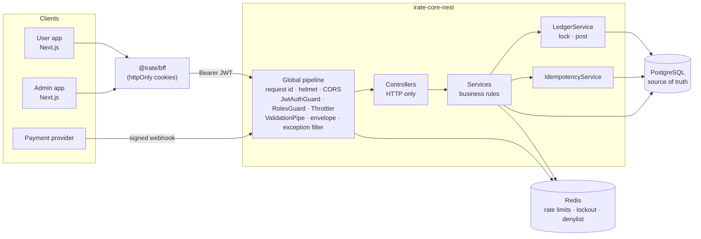

# iRate Core (NestJS)

A production-style **fintech wallet and ledger API** built with NestJS 12, Prisma 7,
PostgreSQL and Redis: customer accounts, KYC, peer-to-peer transfers, card deposits
through a payment-provider abstraction (sandbox and Paystack), and an admin back
office. Every naira moves through a **double-entry ledger** with **row-level
locking** and **database-backed idempotency**.

It is a rewrite of the original Express backend
([iamBlissMedik/irate-core](https://github.com/iamBlissMedik/irate-core)). It keeps the
HTTP contract, so the existing Next.js user and admin apps
([iamBlissMedik/iRate](https://github.com/iamBlissMedik/iRate): `@irate/contracts`,
`@irate/bff`) work against it unchanged, and it fixes the money, security and workflow
defects in the original ([docs/MIGRATING-FROM-EXPRESS.md](docs/MIGRATING-FROM-EXPRESS.md)).
A Go implementation of the same contract lives in
[iamBlissMedik/irate-core-go](https://github.com/iamBlissMedik/irate-core-go).

---

## Contents

- [Highlights](#highlights)
- [Architecture](#architecture)
- [Quick start](#quick-start)
- [How money moves](#how-money-moves)
- [Security model](#security-model)
- [API overview](#api-overview)
- [Configuration](#configuration)
- [Testing](#testing)
- [Project layout](#project-layout)
- [Design decisions](#design-decisions)
- [Roadmap](#roadmap)

## Highlights

| Area | What it does |
| --- | --- |
| **Ledger** | Every movement is one balanced double-entry journal. Postgres re-checks it: a deferred trigger rejects unbalanced journals at `COMMIT`, ledger rows are append-only, entries must satisfy `after = before ± amount`, and customer balances have a `CHECK (balance >= 0)`. |
| **Concurrency** | Pessimistic `SELECT … FOR UPDATE` locks taken in a fixed order, so transfers can't overdraw or deadlock. Proven by tests: 50 concurrent transfers against a balance that covers 20 (exactly 20 succeed), and opposite-direction storms between the same wallets. |
| **Idempotency** | The `Idempotency-Key` is stored **in the same database transaction** as the money movement. Retries replay the original response, a key reused with a different body is rejected, and keys are scoped per user. |
| **Payments** | A `PaymentProvider` interface with a signed **sandbox** and **Paystack** (hosted checkout, HMAC-SHA512 webhooks, server-side verification before every credit). Webhooks are de-duplicated and credit each deposit exactly once. |
| **Auth** | 15-minute JWTs plus opaque refresh tokens stored hashed and **rotated on every use**, with stolen-token detection, multi-device sessions, logout-all, a Redis denylist, argon2id and login lockout. |
| **KYC** | A compare-and-set state machine (PENDING → VERIFIED/REJECTED; decisions are final). Unverified customers have a daily transfer cap, checked under the wallet lock. |
| **Operations** | Structured pino logs with request ids, liveness/readiness probes, graceful shutdown, fail-fast config validation with production guardrails, an hourly cleanup job, a ledger reconciliation endpoint, Swagger docs, Docker and CI. |

## Architecture



- **Feature modules** (`auth`, `users`, `wallets`, `transactions`, `kyc`, `payments`, `admin`) each own a controller (HTTP only), services (business rules) and DTOs (validation and Swagger). Controllers return plain data; a global interceptor wraps it in `{ success, message, data }`.
- **Money moves in exactly one place**, `LedgerService`. Transfers, deposits and admin credits all call it inside a database transaction.
- **Secure by default.** `JwtAuthGuard` is global, so a route is private unless marked `@Public()`. `@Roles('ADMIN')` protects the whole admin controller.
- **State.** PostgreSQL holds everything that matters: balances, ledger, sessions, idempotency records and audit logs. Redis holds only short-lived state that can be rebuilt (rate-limit counters, login failures, the access-token denylist), so losing Redis never loses or duplicates money.

More detail: [docs/ARCHITECTURE.md](docs/ARCHITECTURE.md).

## Quick start

**Prerequisites:** Node 22+ (24 recommended), plus either Docker, or a local PostgreSQL 14+ and Redis 6.2+.

### Option A: local Postgres and Redis

```bash
npm install
cp .env.example .env          # set DATABASE_URL / REDIS_URL
createdb irate_core_nest
npm run db:generate           # Prisma client
npm run db:deploy             # apply migrations
npm run db:seed               # demo users and balances
npm run start:dev             # http://localhost:8000, Swagger at /docs
```

### Option B: Docker

```bash
docker compose up --build -d      # Postgres, Redis, migrations, API
docker compose run --rm seed      # demo users and balances
curl localhost:8000/ready         # {"status":"ready",...}
```

### Demo data (`npm run db:seed`)

The seed goes through the real services (registration, KYC review, admin credit,
transfer), so every balance is backed by a balanced journal and reconciliation passes.

| Role | Email | Password | Account | Balance |
| --- | --- | --- | --- | --- |
| ADMIN | `admin@irate.dev` | `Admin123!` | – | – |
| USER | `ada@irate.dev` | `Password123!` | `1000000001` | ₦45,500 (KYC verified, sent ₦2,500 to Bola) |
| USER | `bola@irate.dev` | `Password123!` | `1000000002` | ₦17,000 (KYC verified) |
| USER | `chidi@irate.dev` | `Password123!` | `1000000003` | ₦0 (no KYC: daily limit applies) |

### Try a transfer

```bash
TOKEN=$(curl -s localhost:8000/api/v1/auth/login -H 'Content-Type: application/json' \
  -d '{"email":"ada@irate.dev","password":"Password123!"}' | jq -r .data.accessToken)

# 1. Name enquiry: who owns this account?
curl -s localhost:8000/api/v1/transactions/resolve/1000000002 -H "Authorization: Bearer $TOKEN"

# 2. Send NGN 2,500.00 (amounts are minor units: 250000 kobo)
KEY=$(uuidgen)
curl -s localhost:8000/api/v1/transactions/transfer -H "Authorization: Bearer $TOKEN" \
  -H 'Content-Type: application/json' -H "Idempotency-Key: $KEY" \
  -d '{"toAccountNumber":"1000000002","amount":250000,"note":"Rent share"}'

# 3. Retry with the same key: same response, header "Idempotent-Replayed: true", no second debit
```

### Point the Next.js apps at it

Both apps already speak this API. Run it on port 8000 and keep the BFF default
`IRATE_API_BASE_URL=http://localhost:8000/api/v1`.

## How money moves

All amounts are **integer minor units** (kobo). Postgres stores them as `BIGINT`,
TypeScript as `bigint`, and JSON as **strings** (`"250000"`), so no JavaScript client
loses precision. Requests accept `250000` or `"250000"` and reject `2500.5`, `"1e5"`,
`"+5"`, negatives and anything beyond `Number.MAX_SAFE_INTEGER`.

A transfer is **one** database transaction:

```text
BEGIN
  SET LOCAL lock_timeout = '5s'
  claim Idempotency-Key              INSERT … ON CONFLICT DO NOTHING  (replay if it already exists)
  load sender + recipient wallets
  SELECT … FROM wallets WHERE id = ANY($1) ORDER BY id FOR UPDATE   -- fixed lock order: no deadlocks
  check: not frozen · balance ≥ amount · KYC daily limit            -- cannot race: rows are locked
  INSERT transactions                 (journal header, unique reference TRF-…)
  UPDATE wallets balance ± amount     (debit sender, credit recipient)
  INSERT ledger_entries ×2            (exact balance_before / balance_after)
  INSERT audit_logs
  store the response on the idempotency key
COMMIT                                -- deferred trigger: debits = credits, or everything rolls back
```

Money entering the platform uses **system accounts** as the other side of the journal.
A deposit debits `SETTLEMENT` and credits the customer; an admin credit debits
`ADJUSTMENTS`. All wallets in a currency therefore always sum to exactly zero, and
`GET /admin/reconciliation` proves it.

## Security model

- **The browser never sees a token.** The Next.js BFF keeps tokens in httpOnly cookies and calls this API server-to-server.
- **Access tokens:** HS256 JWTs (15 min) with a pinned algorithm (blocks `alg: none` and algorithm confusion), issuer and audience checks.
- **Refresh tokens:** 256-bit random values in an `HttpOnly; Secure; SameSite=Strict` cookie scoped to `/api/v1/auth`, stored only as SHA-256 hashes and rotated on every refresh. Reusing an already-rotated token outside a short grace window revokes the whole session (stolen-token detection). The role is re-read from the database on every refresh.
- **Revocation:** logout denylists the access token's `jti` in Redis until it expires; logout-all revokes every session on every device. If Redis is unreachable, authentication fails **closed** (503).
- **Passwords:** argon2id (OWASP parameters), a dummy hash for unknown emails (no timing oracle), and transparent re-hashing when the parameters change.
- **Brute force:** per-email lockout (5 failures → 15 minutes, `ACCOUNT_LOCKED` + `Retry-After`) plus per-IP limits on credential endpoints. Unknown email and wrong password return the same error.
- **Rate limiting:** Redis-backed, **per user** on authenticated routes (behind the BFF every request shares one IP, so per-IP limits would make all customers share one budget) and per IP otherwise, with tighter limits for transfers and name enquiry. Fails open, because it protects capacity rather than correctness.
- **Authorization:** another customer's wallet returns 404, exactly like a missing one (no existence oracle). Admins can't credit their own wallet or review their own KYC.
- **Input:** unknown fields are rejected (`ammount` → 400), strict money parsing, per-field validation errors, LIKE-wildcard escaping in search, control characters rejected in names and notes, and a 100 KB body limit.
- **Headers:** helmet (HSTS, nosniff, frame protections…), `Cache-Control: no-store` on every response, an exact CORS allowlist, and `X-Forwarded-For` trusted only for `TRUST_PROXY_HOPS` proxies.
- **Production guardrails:** the API refuses to boot with development secrets, insecure cookies, wildcard CORS or rate limiting disabled. Swagger and the deposit simulator are off in production.

## API overview

Base path `/api/v1`. Successful responses use `{ "success": true, "message", "data" }`.
Errors use `{ "success": false, "message", "code", "errors"?: [{ field, message }], "requestId" }`.
Clients branch on `code`, never on `message`. Interactive docs: **`/docs`** (OpenAPI JSON at `/docs/openapi.json`, importable into Postman).

🔒 bearer token · 👑 ADMIN · 🔑 `Idempotency-Key` required

| Method | Path | | Description |
| --- | --- | --- | --- |
| POST | `/auth/register` | | Create a customer and their wallet; returns the account number |
| POST | `/auth/login` | | Access token (body) and refresh token (cookie) |
| POST | `/auth/refresh` | 🍪 | Rotate the refresh token, issue a new access token |
| POST | `/auth/logout` | | End this session (access token and/or cookie) |
| POST | `/auth/logout-all` | 🔒 | End every session on every device |
| GET | `/users/me` · `/users/me/overview` · `/users/:userId` | 🔒 | Profile, home-screen overview, profile by id (self or admin) |
| POST · GET | `/wallets` | 🔒 | Open a wallet (one per currency) · list mine |
| GET | `/wallets/:walletId/balance` | 🔒 | Balance (owner only) |
| GET | `/transactions/resolve/:accountNumber` | 🔒 | Name enquiry |
| POST | `/transactions/transfer` | 🔒🔑 | Send money by account number |
| GET | `/transactions/me` · `/transactions/:walletId/transactions` | 🔒 | Statements (paginated) |
| POST · GET | `/kyc/submit` · `/kyc/status` | 🔒 | Submit / view KYC |
| POST · GET | `/payments/deposits` | 🔒🔑 | Start a top-up (returns a checkout URL) · list mine |
| GET | `/payments/deposits/:depositId` | 🔒 | Deposit status |
| POST | `/payments/sandbox/deposits/:depositId/simulate` | 🔒 | Dev only: settle a sandbox deposit |
| POST | `/webhooks/payments/:provider` | sig | Provider webhooks (signature-verified) |
| GET | `/admin/dashboard/overview` · `/admin/users/stats` · `/admin/wallets/balance` | 👑 | Dashboard stat cards |
| GET | `/admin/users` · `/admin/me` | 👑 | User directory (search, pagination) · own profile |
| POST | `/admin/credit/:walletId` | 👑🔑 | Credit a wallet (via `ADJUSTMENTS`) |
| PATCH | `/admin/wallets/:walletId/status` | 👑 | Freeze / unfreeze (post-no-debit) |
| GET · PATCH | `/admin/kyc` · `/admin/kyc/:kycId/review` | 👑 | KYC queue · approve/reject |
| GET | `/admin/reconciliation` | 👑 | Ledger invariant check |

Probes (outside `/api/v1`): `GET /health` (liveness), `GET /ready` (Postgres and Redis; 503 while draining).

## Configuration

All configuration comes from environment variables, validated at startup by
[src/config/env.ts](src/config/env.ts); [.env.example](.env.example) documents every
one. The most important:

| Variable | Default | Notes |
| --- | --- | --- |
| `DATABASE_URL` | **required** | PostgreSQL connection string |
| `REDIS_URL` | `redis://127.0.0.1:6379/0` | |
| `JWT_ACCESS_SECRET` | dev default | **Required in production**, ≥ 32 chars |
| `PAYMENTS_PROVIDER` | `sandbox` | `sandbox` or `paystack` (with `PAYSTACK_SECRET_KEY`) |
| `CORS_ALLOWED_ORIGINS` | `http://localhost:3000,http://localhost:9000` | Exact origins |
| `TRUST_PROXY_HOPS` | `0` | Reverse proxies in front of the API. Behind the Next.js BFF use `1` (it forwards the browser's IP) and keep the API private |
| `UNVERIFIED_DAILY_TRANSFER_LIMIT` | `5000000` | NGN 50,000/day without KYC; `0` disables |
| `MAX_TRANSACTION_AMOUNT` | `1000000000` | NGN 10,000,000 per transaction |
| `BUSINESS_TIMEZONE` | `Africa/Lagos` | Defines "today" for limits and stats |

## Testing

```bash
npm test                 # unit tests, no infrastructure (~1s)
npm run test:e2e         # the real app over HTTP against PostgreSQL + Redis
npm run test:cov         # unit coverage
npm run lint && npm run typecheck && npm run format:check
```

The e2e suite boots the **real** application (same modules, guards, filters and
middleware as production) against a dedicated test database (`TEST_DATABASE_URL`,
default `irate_core_nest_test`) and Redis DB 14 (`TEST_REDIS_URL`). It proves the
guarantees that matter:

- 50 concurrent transfers against a balance that covers 20: **exactly 20 succeed**, the balance ends at 0, every running balance is distinct and exact, and the ledger reconciles.
- 40 transfers in both directions between the same wallets: **no deadlocks**, money conserved.
- 20 simultaneous requests with one `Idempotency-Key`: **one debit**, 19 replays.
- 20 concurrent webhook deliveries for one deposit: **credited once**. Bad signatures, stale timestamps and tampered bodies are rejected; amount mismatches are flagged, not credited.
- Paystack against a local API stub: no credit until Paystack's verify API confirms the charge, and the verified amount wins over the webhook body.
- Refresh-token rotation, race tolerance and theft detection; logout and logout-all; lockout; forged and `alg: none` tokens; IDOR checks; KYC state machine under concurrent reviews; daily limits; frozen wallets; the append-only ledger at the database level; rate limits per user and per IP.

The e2e suite alone covers ~90% of statements. Unit tests cover the pure logic
(money parsing, env guardrails, signature verification, posting math, error mapping).

## Project layout

```text
prisma/
  schema.prisma                 data model (money = BIGINT minor units, UUIDv7 ids, timestamptz)
  migrations/                   SQL migrations, including the ledger invariants (CHECKs, triggers)
src/
  main.ts · app.module.ts       bootstrap · composition root (global guards, pipe, filter, interceptor)
  app.setup.ts                  HTTP middleware shared by main.ts and the e2e tests
  config/env.ts                 zod-validated configuration with production guardrails
  common/                       decorators, errors, exception filter, envelope, validation, throttling, utils
  infra/                        Prisma (UTC-pinned pool, error helpers), Redis, logging
  modules/
    auth/                       register/login/refresh/logout, JWT, argon2id, lockout, refresh rotation, guards
    users/                      profiles, home-screen overview, admin directory
    wallets/                    wallets, balances, account numbers, name enquiry
    ledger/                     THE place money moves: lock + post · system wallets · reconciliation
    transactions/               P2P transfers, daily limits, statements
    kyc/                        submission + review state machine
    payments/                   provider interface, sandbox + Paystack, deposits, webhooks
    admin/                      dashboard stats, credits, freeze, KYC review, reconciliation
    idempotency/ · audit/       transactional idempotency keys · in-transaction audit log
    health/ · maintenance/      probes and graceful drain · hourly cleanup job
  scripts/seed.ts               demo data through the real services
test/                           e2e suites + harness (test/support/app.ts)
docs/                           architecture, payments, migration notes, module recipe
```

## Design decisions

Explained in [docs/ARCHITECTURE.md](docs/ARCHITECTURE.md#design-decisions):

1. Double-entry ledger with database-enforced invariants.
2. Pessimistic row locks acquired in a fixed order (instead of optimistic retries).
3. Idempotency keys in the same Postgres transaction (instead of a Redis cache).
4. Opaque, rotating refresh tokens with reuse detection (instead of long-lived JWTs).
5. Redis only for disposable state.
6. Prisma for the data model, raw SQL only where it matters (row locks, aggregates, reconciliation).
7. Following the official Nest 12 template: ESM, Vitest, oxlint.

Adding a feature? Follow [docs/ADDING-A-MODULE.md](docs/ADDING-A-MODULE.md).
Payments and Paystack setup: [docs/PAYMENTS.md](docs/PAYMENTS.md).

## Roadmap

Deliberately out of the MVP:

- **Payouts (withdrawals to bank):** hold funds in a `PAYOUTS_PENDING` system account at request time, settle or reverse on the provider webhook ([design](docs/PAYMENTS.md#roadmap-payouts)).
- **Transactional outbox** for domain events (email/push notifications, analytics).
- **Transaction PIN / step-up auth** for transfers above a threshold.
- **Fees and multi-currency FX:** the journal model and per-currency system accounts already support it; `LedgerService.post` needs per-leg amounts (today every leg moves the same amount).
- **Keyset pagination and monthly partitioning** of `ledger_entries` at very high volume.
- **OpenTelemetry tracing and Prometheus metrics** (request ids already propagate).
